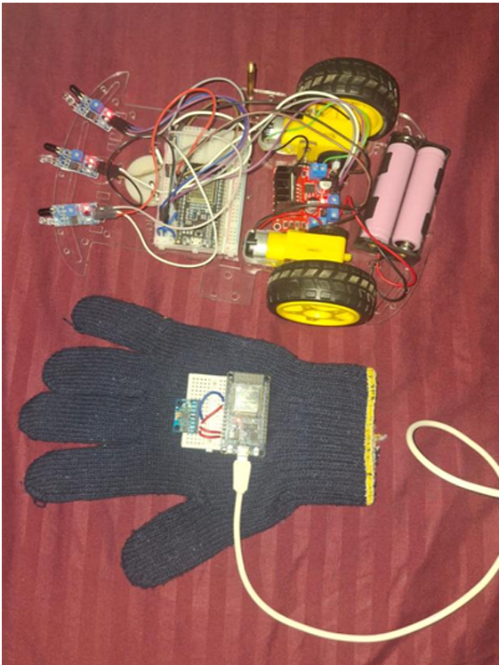

# Gesture-Controlled Fire Detection Bot

A robot that is driven by tilting a hand-held controller, with no buttons or joystick. While it drives, three flame sensors watch for fire, and a camera on the robot streams live video to any phone or laptop on the same Wi-Fi.



*Top: the robot, with three flame sensors at the front, an ESP32, an L298N motor driver, two geared motors and a battery holder. Bottom: the glove controller, with an ESP32 and an MPU6050 on a breadboard.*

## What the robot does

- **Drives by hand tilt.** An MPU6050 motion sensor on a controller board reads how the hand is tilted. Tilt forward and the robot goes forward, tilt back and it reverses, tilt left or right and it turns. Keep the hand flat and it stops.
- **Detects fire.** Three infrared flame sensors are mounted on the robot. When any one of them sees a flame, the robot stops right away, a buzzer sounds, and the Serial Monitor prints which sensor saw it.
- **Ignores driving commands during a fire.** The robot will not move again until all three sensors stop seeing a flame.
- **Stops if the controller goes quiet.** If the robot gets no command for half a second (controller switched off or out of range), it stops.
- **Streams live video.** A separate ESP32-CAM sends video over Wi-Fi, so the view in front of the robot can be watched live.

## How it works

1. The **controller** (an ESP32 with an MPU6050) works out the tilt angles (pitch and roll) from the sensor. A smoothing filter stops the readings from jumping around.
2. If the tilt is more than **10 degrees** in any direction, the controller picks a command: `FORWARD`, `BACKWARD`, `LEFT`, `RIGHT`. Otherwise it picks `STOP`.
3. It sends that command to the robot **10 times a second** over **ESP-NOW**, a direct ESP32-to-ESP32 wireless link. No Wi-Fi router is needed for driving.
4. The **robot** (a second ESP32) receives the command and drives the motors through an **L298N motor driver**.
5. Between commands, the robot keeps checking its three flame sensors. A fire reading always overrides driving.
6. The **ESP32-CAM** is a separate board with its own Wi-Fi connection. It does not touch the ESP-NOW link between the controller and the robot.

## Hardware

| Part | Used for |
|---|---|
| ESP32 (x2) | One as the controller, one on the robot |
| MPU6050 | Measures hand tilt |
| L298N motor driver | Runs the left and right motors |
| DC motors, chassis, battery | The robot body |
| 3 x infrared flame sensors | Fire detection |
| Buzzer | Alarm when fire is detected |
| ESP32-CAM (AI Thinker) | Live video |

## Wiring (pins used in the code)

**Controller ESP32**

| Connection | Pin |
|---|---|
| MPU6050 SDA | GPIO 32 |
| MPU6050 SCL | GPIO 33 |

**Robot ESP32**

| Connection | Pin |
|---|---|
| L298N MOTOR_A1 / MOTOR_A2 | GPIO 33 / 25 |
| L298N MOTOR_B1 / MOTOR_B2 | GPIO 26 / 27 |
| Flame sensor 1, 2, 3 | GPIO 32, 35, 34 |
| Buzzer | GPIO 14 |

If you wire the buzzer to a different pin, change `BUZZER_PIN` at the top of `robot/robot.ino`. The flame sensors are expected to read LOW when they see fire, which is how most IR flame sensor modules work.

## Folder structure

```
.
├── README.md
├── controller/                    # Gesture controller (ESP32 + MPU6050)
│   └── controller.ino
├── robot/                         # Robot (motors, flame sensors, buzzer)
│   └── robot.ino
├── camera/
│   └── CameraWebServer/           # ESP32-CAM live video
├── docs/
│   └── robot_and_glove_controller.png
├── tools/
│   └── get_mac_address/           # Prints an ESP32's MAC address
└── extras/
    ├── blynk_control/             # Optional: drive from the Blynk phone app (ESP8266)
    └── motor_test/                # Optional: test the motor wiring (ESP8266)
```

## What you need installed

- Arduino IDE with the ESP32 board package, version 3.x
- The **MPU6050** library (for the controller)
- The **Blynk** library (only if you use the optional Blynk sketch)

## Setup

1. Upload `tools/get_mac_address` to the **robot's** ESP32. Open the Serial Monitor at 115200 baud and write down the MAC address it prints.
2. Open `controller/controller.ino` and paste that MAC address into `receiverAddress[]`.
3. Upload `robot/robot.ino` to the robot's ESP32.
4. Upload `controller/controller.ino` to the controller ESP32.
5. Set up the camera using the steps below.
6. Power everything on. Hold the controller flat to stay still, and tilt it to drive.

## Camera setup

The camera sketch is Espressif's standard CameraWebServer example, set up for the AI Thinker ESP32-CAM.

1. Open `camera/CameraWebServer/CameraWebServer.ino` in Arduino IDE.
2. At the top of the file, replace `YOUR_WIFI_NAME` and `YOUR_WIFI_PASSWORD` with your own Wi-Fi details. Do not commit your real password to GitHub.
3. Choose the board **AI Thinker ESP32-CAM**, enable PSRAM, and set **Partition Scheme** to **Huge APP (3MB No OTA/1MB SPIFFS)**. The camera page does not fit in the default partition.
   The AI Thinker board has no USB port. Upload with an ESP32-CAM programmer board, or with an FTDI adapter and GPIO 0 connected to GND while uploading.
4. Upload the sketch and open the Serial Monitor at 115200 baud. It prints the camera's IP address.
5. In a browser on the same Wi-Fi, open `http://<IP address>` for the camera page, or `http://<IP address>:81/stream` for the video only.

The ESP32-CAM restarts at random if its power supply is weak, so give it a steady 5V supply.

## Credits

The code in `camera/CameraWebServer` comes from Espressif's CameraWebServer example (Apache 2.0 license). Only the Wi-Fi details were changed. The controller and robot code was written for this project.

## Author

Nandhini N, final-year B.Tech ECE student at VIT
